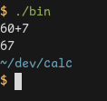
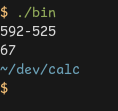

Калькулятор написан на асемблере в качестве практики.

Что умеет:
- не поддерживает пробелы
- может вычитать и находить сумму
- работает на linux x86-64

Необходимые пакеты для запуска:
```bash
sudo pacman -S nasm binutils gdb
```

Для компиляции кода и запуска необходимо вызвать скрипт (без расширения):
```bash
./run.sh index
```
